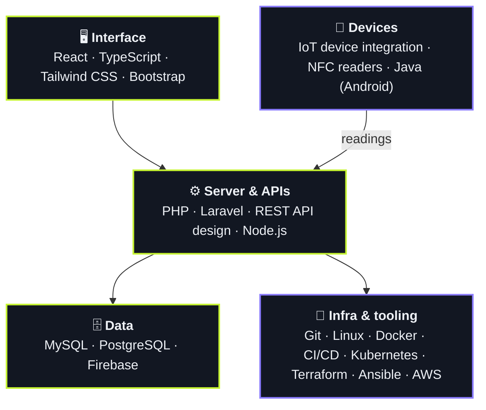
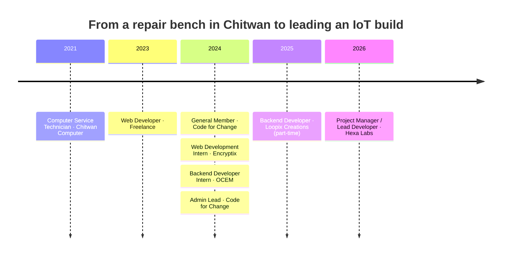

<!--
  GitHub profile README for github.com/Sandesh-Gadal
  Theme: "Midnight & Lime", same tokens as sandeshgadal.com.np
    page #0B0E14 · panel #121722 · panel-2 #1A2030 · ink #EEF1F6 · muted #9AA3B2
    lime #C6F432 (accent) · violet #8B7CFF (secondary) · led #1FAE62 (live/current only)
  Light-mode variants use: paper #F3F4EF · lime-ink #4C7A00 · violet #6A5CF0
  Setup notes (snake workflow, repo name): .claude/md/github-profile-SETUP.md
-->

<!-- ═══════════════════════════ HEADER ═══════════════════════════ -->

 

 

## `01` Right now

I build systems end to end: the database underneath, the API in the middle, the interface people click, and the devices out in the field.

| | |
| :-- | :-- |
| 🟢 **Building** | An automatic milk collection system at **Hexa Labs**. I lead the build, design how the milk analysers connect, and bring their readings into the system. |
| 🔧 **Part-time** | An MIS platform for **Loopix Creations**: system design, database schema, Laravel REST APIs, slow MySQL queries tuned. |
| 📚 **Learning** | DevOps: Docker, Kubernetes, Terraform, Ansible, AWS and CI/CD pipelines. |
| ✍️ **Writing** | Plain-language tutorials, starting with [Essential Linux commands for beginners](https://bosc.org.np/blogs/basic-linux-commands/) on BOSC Nepal. |
| 💬 **Ask me about** | Laravel APIs, MySQL schemas and queries, wiring hardware (NFC readers, analysers) into a web app. |

 

## `02` The whole stack

Where each tool sits, from what users touch down to the hardware.

Grouped by how much you'd trust me with it, not by self-rated bars:

<table>
  <tr>
    <td width="130"><b>Daily</b> What I ship with at work</td>
    <td> + REST API design · IoT device integration</td>
  </tr>
  <tr>
    <td><b>Comfortable</b> Used on real projects</td>
    <td> + NFC readers</td>
  </tr>
  <tr>
    <td><b>Learning</b> Actively working toward</td>
    <td></td>
  </tr>
</table>

 

## `03` Things I've shipped

<table>
  <tr>
    <td width="50%" valign="top">
      
      <h3>🌾 Aabhaa</h3>
      <code>PRODUCT · ANDROID</code>
      
A farming assistant that puts local weather, crop recommendations and soil NPK readings in one app.

      <ul>
        <li>Built the Android client in Java, backed by a Laravel API and Firebase</li>
        <li>Combined a third-party weather feed with soil nutrient data to drive the recommendations</li>
      </ul>
      <a href="https://github.com/Sandesh-Gadal/Aabhaa">Source →</a>
    </td>
    <td width="50%" valign="top">
      
      <h3>📰 Digital Journal Publication System</h3>
      <code>OXFORD COLLEGE · IN PRODUCTION</code>
      
Takes an academic journal online end to end: submission, peer review, editorial decisions and publication.

      <ul>
        <li>Built role-based workflows for authors, reviewers and editors</li>
        <li>Built the React front end on a Laravel and MySQL back end</li>
      </ul>
      <a href="https://blog.oxfordcollege.edu.np">Visit live →</a>
    </td>
  </tr>
  <tr>
    <td width="50%" valign="top">
      
      <h3>📇 NFC E-Attendance</h3>
      <code>OPEN SOURCE</code>
      
Students tap an NFC card and attendance is recorded. Reports build themselves, so nobody fills in a register by hand.

      <ul>
        <li>Built a Laravel REST API that receives card reads and writes attendance to MySQL</li>
        <li>Automated per-class and per-student reports</li>
      </ul>
      <a href="https://github.com/Sandesh-Gadal/eAttendance">Source →</a>
    </td>
    <td width="50%" valign="top">
      
      <h3>🖥️ Chitwan Computer</h3>
      <code>CLIENT WORK</code>
      
Storefront and product catalogue for a local computer shop, with an admin panel the owners use to update products themselves.

      <ul>
        <li>Built a Laravel admin for products and site content, so routine updates need no developer</li>
        <li>Built the React landing and product listing pages</li>
      </ul>
      <a href="https://chitwancomputer.com.np">Visit live →</a> · <a href="https://github.com/Sandesh-Gadal/chitwan-computer-website">Source →</a>
    </td>
  </tr>
</table>

  
  

 

## `04` Where I've worked

<b>What I did in each role</b> (click to open)

 

| Role | When | What I did |
| :-- | :-- | :-- |
| **Project Manager / Lead Developer** · Hexa Labs | Apr 2026 – now | Lead development of an automatic milk collection system. Design how the milk analysers connect and bring their readings into the system. Own third-party integrations and run the project day to day. |
| **Backend Developer** · Loopix Creations | May 2025 – now · part-time | Architect an MIS platform end to end: system design, database schema and backend logic. Build REST APIs in Laravel and tune slow MySQL queries. Deploy and maintain services across hybrid hosting. |
| **Admin Lead** · Code for Change | 2024 – 2025 · 1 yr term | Planned and ran logistics for workshops and tech programmes. Coordinated volunteers and external partners. |
| **Backend Developer Intern** · OCEM | Nov 2024 – Jan 2025 | Built React and Tailwind UI components connected to Laravel services. Improved the responsiveness of existing pages. Shipped through a GitLab merge-request review flow. |
| **Web Developer** · Self-employed | Sep 2023 – Dec 2024 | Delivered Laravel and React sites for clients, from scoping to deployment, and handled client communication through to handover. |
| **Web Development Intern** · Encryptix | Jul – Aug 2024 · remote | Built small projects and UI components in semantic HTML, CSS and JavaScript. |
| **General Member** · Code for Change | Jan – Dec 2024 | Contributed to community projects and helped run workshops. |
| **Computer Service Technician** · Chitwan Computer | Feb 2021 – Jul 2023 | Diagnosed and repaired hardware and software faults. Installed and maintained operating systems for customers. |

 

## `05` On GitHub

<picture>
  <source media="(prefers-color-scheme: dark)" srcset="https://github-readme-stats.vercel.app/api?username=Sandesh-Gadal&show_icons=true&include_all_commits=true&count_private=true&rank_icon=github&hide_border=true&bg_color=0B0E14&title_color=C6F432&icon_color=8B7CFF&text_color=EEF1F6&ring_color=C6F432"/>
  
</picture>
<picture>
  <source media="(prefers-color-scheme: dark)" srcset="https://github-readme-stats.vercel.app/api/top-langs/?username=Sandesh-Gadal&layout=compact&langs_count=8&hide_border=true&bg_color=0B0E14&title_color=C6F432&text_color=EEF1F6"/>
  
</picture>

<picture>
  <source media="(prefers-color-scheme: dark)" srcset="https://streak-stats.demolab.com?user=Sandesh-Gadal&hide_border=true&border_radius=12&background=0B0E14&stroke=1A2030&ring=C6F432&fire=8B7CFF&currStreakNum=EEF1F6&sideNums=EEF1F6&currStreakLabel=C6F432&sideLabels=9AA3B2&dates=9AA3B2"/>
  
</picture>

<!-- Contribution snake: generated daily by .github/workflows/snake.yml into the `output` branch (see SETUP) -->
<picture>
  <source media="(prefers-color-scheme: dark)" srcset="https://raw.githubusercontent.com/Sandesh-Gadal/Sandesh-Gadal/output/snake-dark.svg"/>
  
</picture>

 

## `06` Writing & badges

| Article | Where | When |
| :-- | :-- | :-- |
| [Essential Linux commands for beginners](https://bosc.org.np/blogs/basic-linux-commands/): the handful of terminal commands a new Linux user actually needs, and what each one does | BOSC Nepal | Oct 2025 · 6 min |

 

<b>☕ Off duty</b>: a quote and a joke, refreshed for you

 

  
    
  

 

## `07` Got a system to build?

I'm open to backend and full-stack roles, and to freelance work on Laravel, APIs and databases. Tell me what you're building; I usually reply within a day, Nepal time.

